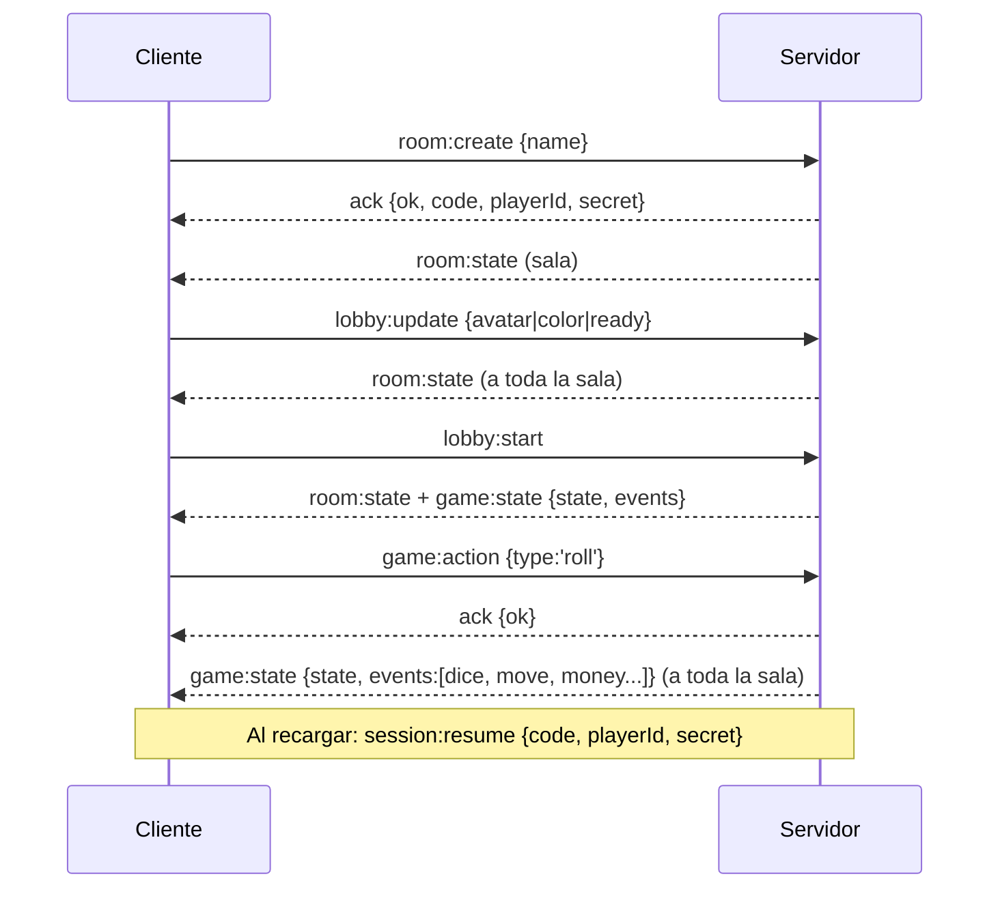

# Ortopoly

Juego de bienes raíces por turnos, multijugador en tiempo real (3 a 8 jugadores), con Node.js + Express + Socket.IO y un cliente web sin build (HTML + CSS + JavaScript con módulos ES).

Es un juego **original** con las mecánicas clásicas del género: comprar, subastar, construir, hipotecar, negociar y fundir a los demás. Los nombres de calles, los mazos ("Fortuna" y "Vecindario"), las fichas y la estética son propios.

---

## 1. Cómo seguir en otra computadora (paso a paso)

1. Instalá **Node.js 18.17 o superior** (recomendado 22): <https://nodejs.org>
2. Descomprimí `ortopoly.zip` en una carpeta.
3. Abrí una terminal en esa carpeta e instalá dependencias:

```bash
npm install
```

4. Corré los tests (tienen que dar 56 de 56 en verde):

```bash
npm test
```

5. Levantá el servidor:

```bash
npm start
```

6. Abrí <http://localhost:3000>. Para probar con 3 jugadores, abrí 3 pestañas (o una normal y dos de incógnito, así cada una tiene su propia sesión).

Para desarrollar con recarga automática del servidor:

```bash
npm run dev
```

Para jugar desde otros dispositivos de tu red local, usá la IP de tu compu (por ejemplo `http://192.168.0.10:3000`).

### Jugar online con amigos que están en otro lado (doble clic)

1. Instalá Node.js (versión LTS) desde <https://nodejs.org> si no lo tenés.
2. Abrí la carpeta `ortopoly` y hacé doble clic en:
   - **Windows**: `JUGAR-ONLINE-Windows.bat`. Si aparece "Windows protegió su PC", elegí *Más información → Ejecutar de todas formas*.
   - **Mac**: `JUGAR-ONLINE-Mac.command`. La primera vez: clic derecho → *Abrir* → *Abrir*.
3. La primera vez instala dependencias y descarga `cloudflared` (un par de minutos). Después aparece un recuadro con un link `https://algo.trycloudflare.com` y se abre el juego en tu navegador.
4. Mandale ese link a tus amigos, creá la sala y compartí el código.

El link funciona mientras esa ventana esté abierta y la compu no se suspenda. Cada vez que lo abrís, el link cambia. Desde una terminal es lo mismo con:

```bash
npm run online
```

---

## 2. Scripts

| Script | Qué hace |
|---|---|
| `npm start` | Servidor en `PORT` (3000 por defecto) |
| `npm run dev` | Igual, pero se reinicia al cambiar archivos |
| `npm test` | Tests del motor, del servidor y de traducciones (Vitest) |
| `npm run online` | Levanta el juego y lo publica con un link temporal de Cloudflare |
| `npm run e2e` | Prueba con navegadores reales: 3 jugadores + espectador (requiere Playwright, ver abajo) |
| `npm run test:watch` | Tests en modo observador |

### Variables de entorno

| Variable | Default | Descripción |
|---|---|---|
| `PORT` | `3000` | Puerto HTTP |
| `PERSIST` | `file` | `file` (guarda en `data/rooms.json`), `redis` o `none` |
| `REDIS_URL` | — | URL de Redis si `PERSIST=redis` (requiere el paquete opcional `redis`) |
| `DISCONNECT_GRACE_MS` | `30000` | Tiempo de gracia antes de considerar ausente a un jugador desconectado |
| `CORS_ORIGIN` | — | Orígenes permitidos (separados por coma) si el cliente se sirve desde otro dominio |

### Prueba end-to-end (opcional)

Instalá Playwright una sola vez y corré la prueba. Levanta su propio servidor, abre 3 jugadores y un espectador, y recorre lobby, partida, subasta, trato, reconexión, fin y revancha:

```bash
npm i -D playwright
```

```bash
npx playwright install chromium
```

```bash
npm run e2e
```

Con `SCREENSHOTS=1 npm run e2e` guarda capturas en `e2e-shots/`.

---

## 3. Despliegue

El servidor guarda las partidas en memoria: desplegá **una sola instancia** (Socket.IO necesita sesiones pegajosas para escalar horizontalmente).

### Render

1. Subí el proyecto a un repo de GitHub.
2. En Render: **New → Blueprint** y elegí el repo (usa `render.yaml`), o **New → Web Service** con:
   - Build: `npm install --omit=dev`
   - Start: `npm start`
   - Health check: `/healthz`
3. WebSockets funcionan sin configuración extra.
4. Para que las partidas sobrevivan a reinicios: agregá un disco persistente montado en `/opt/render/project/src/data`, o usá Redis (`PERSIST=redis`, `REDIS_URL=...`).

### Railway

1. **New Project → Deploy from GitHub repo**.
2. Railway detecta Node y corre `npm install` y `npm start`. Asigna `PORT` solo.
3. Opcional: agregá un servicio Redis y definí `PERSIST=redis` y `REDIS_URL=${{Redis.REDIS_URL}}`.

---

## 4. Cómo se juega

- **Inicio**: poné tu nombre y **Crear sala**, o ingresá un código de 5 letras y **Unirse**. El enlace `/?sala=CODIGO` lleva directo a la sala.
- **Espectadores**: si te unís a una partida ya empezada (o a una sala con 8 jugadores) entrás a mirar y chatear. En la revancha pasás a jugar si hay lugar.
- **Sala de espera**: cada uno elige ficha y color (únicos) y marca **Estoy listo**. El anfitrión (👑) configura reglas, puede expulsar y agregar bots, y empieza con 3 a 8 jugadores.
- **Turno**: Tirar dados → mover → resolver la casilla → (opcional) construir, hipotecar o negociar → Terminar turno.
- Hacé clic en cualquier casilla para ver su título de propiedad. Si es tuya, desde ahí construís, vendés o hipotecás. También desde **Mis bienes**.
- **Proponer trato** está siempre disponible, aunque no sea tu turno.
- **Atajos de teclado**: `R` o `Espacio` = tirar, `E` = terminar turno, `T` = proponer trato, `Esc` = cerrar un diálogo no bloqueante.
- Arriba a la derecha: idioma (español o inglés), sonido y modo claro/oscuro.

---

## 5. Arquitectura

```
ortopoly/
├── package.json
├── render.yaml                 # despliegue en Render
├── README.md
├── data/                       # persistencia en archivo (rooms.json)
├── engine/                     # MOTOR DE REGLAS PURO (sin red); lo usan servidor, tests y navegador
│   ├── board.js                #   40 casillas, precios, alquileres, grupos
│   ├── cards.js                #   mazos Fortuna (chance) y Vecindario (community), 16 c/u
│   ├── rng.js                  #   dados y barajado (RNG inyectable)
│   ├── util.js                 #   RuleError, log estructurado, eventos
│   ├── bank.js                 #   dinero, deudas en cola, bancarrota
│   ├── legal.js                #   chequeos de legalidad (servidor valida; cliente habilita botones)
│   ├── rules.js                #   turnos, dados, cárcel, casillas, cartas, construir, hipotecas
│   ├── auction.js              #   subastas de propiedades y de casas (escasez)
│   ├── trade.js                #   tratos y contraofertas
│   ├── bot.js                  #   bots simples y piloto automático
│   └── game.js                 #   createGame, applyAction (atómico), tick, desconexiones, vista pública
├── server/
│   ├── index.js                # Express + Socket.IO, cabeceras de seguridad, bucles de tick y guardado
│   ├── rooms.js                # salas, lobby, sesiones, bots, temporizadores, limpieza
│   ├── persistence.js          # memoria / archivo / Redis
│   ├── rateLimit.js            # token bucket por socket
│   └── sanitize.js             # nombres, chat y códigos
├── shared/
│   ├── avatars.js              # 8 fichas emoji + 8 colores
│   └── themes/                 # temas intercambiables (solo nombres y colores)
│       ├── index.js
│       ├── puerto.js           #   "Puerto Ventura" (por defecto)
│       └── buenos-aires.js     #   calles de Buenos Aires
├── public/
│   ├── index.html
│   ├── css/style.css           # paleta propia, claro/oscuro, responsive
│   └── js/
│       ├── main.js             # router de pantallas, tema, sonido, idioma
│       ├── net.js              # cliente Socket.IO (envía intenciones)
│       ├── store.js            # estado recibido del servidor
│       ├── audio.js            # sonidos con Web Audio API
│       ├── dom.js              # helper h() (sin innerHTML)
│       ├── i18n/               # es.js y en.js completos (un test verifica que tengan las mismas claves)
│       └── ui/
│           ├── home.js lobby.js game.js over.js
│           ├── board.js        # tablero CSS Grid, fichas animadas, dados 3D, cartas
│           ├── panels.js       # jugadores, mis bienes, registro, chat
│           ├── dialogs.js      # título, compra, subasta, deuda, hipoteca, trato, anfitrión
│           ├── trade.js        # compositor de tratos
│           ├── modals.js toast.js format.js
├── scripts/
│   └── e2e.mjs                 # prueba con navegadores reales (npm run e2e)
└── tests/                      # Vitest: reglas, construcción, subastas, bancarrota, tratos, servidor, simulación, i18n
```

### Principios

- **El servidor es la única fuente de verdad.** El cliente solo envía intenciones (`{ type: 'buy' }`) y dibuja el estado que recibe.
- **Motor puro y testeable.** `engine/` no importa nada de Node ni del navegador. El azar se inyecta (`ctx.rng`): el servidor usa `crypto.randomInt` y los tests usan dados fijos.
- **Acciones atómicas.** `applyAction` clona el estado antes de aplicar; si la regla falla, se restaura y devuelve `{ ok: false, error }`. Node es de un solo hilo, así que dos acciones "simultáneas" se serializan y la segunda se valida contra el estado ya actualizado.
- **Estado JSON serializable** con log estructurado `{ k, p }` que el cliente traduce con i18n.
- **Información oculta:** la vista pública (`publicView`) no incluye el orden de los mazos.

---

## 6. Eventos Socket.IO

Todas las llamadas cliente → servidor usan *acknowledgement*: el servidor responde `{ ok: true }` o `{ ok: false, error: 'codigo' }`.



### Cliente → servidor

| Evento | Payload | Quién | Notas |
|---|---|---|---|
| `room:create` | `{ name }` | cualquiera | ack: `{ code, playerId, secret }` |
| `room:join` | `{ code, name }` | cualquiera | en lobby entra como jugador (máx. 8); con partida en curso o sala llena, como espectador |
| `session:resume` | `{ code, playerId, secret }` | jugador | reconexión (token en localStorage) |
| `room:leave` | — | jugador | en partida queda ausente |
| `lobby:update` | `{ avatar?, color?, ready?, name? }` | jugador | ficha y color únicos |
| `lobby:settings` | `{ settings }` | anfitrión | dinero, timer, tema, reglas de la casa |
| `lobby:kick` | `{ playerId }` | anfitrión | |
| `lobby:addBot` | — | anfitrión | requiere regla "Bots" |
| `lobby:start` | — | anfitrión | 3-8 jugadores, todos listos |
| `game:action` | `{ type, ... }` | jugador | ver tabla de acciones |
| `game:host` | `{ type: 'replaceWithBot' \| 'bankrupt' \| 'endGame' \| 'dismiss', playerId? }` | anfitrión | |
| `game:rematch` | — | anfitrión | vuelve al lobby con la misma sala |
| `chat:send` | `{ text }` | jugador | sanitizado, máx. 240 caracteres |
| `chat:react` | `{ emoji }` | jugador | 👏 😂 😱 😡 🤑 🙏 🔥 💸 |

### Acciones de `game:action`

| `type` | Extra | Cuándo |
|---|---|---|
| `roll` | — | tu turno, fase `roll` |
| `payBail` / `useJailCard` | — | preso, antes de tirar |
| `buy` / `decline` | — | fase `buy` (`decline` dispara la subasta) |
| `endTurn` | — | fase `end` |
| `build` / `sell` | `pos` | construir en tu turno; vender en tu turno o con deuda |
| `mortgage` / `unmortgage` | `pos` | cuando quieras (deshipotecar sin deuda) |
| `mortgageDecision` | `pos, lift` | al recibir una hipotecada: 10% o levantarla |
| `payDebt` / `declareBankruptcy` | — | con deuda activa |
| `bid` / `withdraw` | `amount` | durante una subasta |
| `proposeTrade` | `offer: { to, give, get }` | cuando quieras |
| `acceptTrade` / `rejectTrade` | `tradeId` | `rejectTrade` del proponente = cancelar |
| `counterTrade` | `tradeId, offer` | destinatario |

`give` / `get` = `{ money, props: [pos...], cards }`.

### Servidor → cliente

| Evento | Payload | Cuándo |
|---|---|---|
| `room:state` | `{ code, hostId, phase, settings, members[], canStart, chat[] }` | cambios en la sala |
| `game:state` | `{ state, events[], serverNow }` | cada cambio del juego. `events`: `dice`, `move`, `card`, `money`, `bought`, `build`, `jail`, `turn`, `auction`, `bid`, `auctionEnd`, `debt`, `trade`, `tradeDone`, `bankrupt`, `gameOver` |
| `chat:message` | `{ id, t, kind, playerId, name, text }` | |
| `chat:reaction` | `{ playerId, emoji, t }` | |
| `room:kicked` | `{ code }` | te expulsaron |
| `session:replaced` | — | abriste la sesión en otra pestaña |

---

## 7. Reglas implementadas

- Dinero inicial configurable ($1500). Banco ilimitado. **32 casas y 12 hoteles** con escasez real.
- Orden por tirada de dados con desempate. Dobles = tirar otra vez; **3 dobles = cárcel sin mover**. Pasar o caer en Salida: $200.
- Propiedad libre: comprar o **subasta obligatoria** entre todos (incluido quien no compró), incremento mínimo $1, retiros, temporizador de 20 s que se renueva 10 s con cada oferta. Empate: gana la primera oferta (la segunda igual se rechaza). Quien va ganando no puede retirarse.
- Alquiler automático; doble en solar sin casas con grupo completo y sin hipotecas. Estaciones 25/50/100/200. Servicios 4× o 10× los dados.
- Impuestos al banco. Estacionamiento sin efecto. Casilla 30 → cárcel.
- **Cárcel**: pagar $50, usar carta o intentar dobles (3 intentos). Salir con dobles mueve pero no da turno extra. Al 3.er fallo paga $50 y mueve. Preso se sigue cobrando, comprando, construyendo y negociando.
- **Construcción uniforme** al construir y al vender; grupo completo y sin hipotecas. 4 casas + 1 = hotel (devuelve 4 casas). Vender = mitad del costo. Vender hotel sin 4 casas en el banco: queda con las casas disponibles y cobrás el resto. Con 3 casas o menos en el banco y otro interesado: **subasta de casas**.
- **Hipotecas**: sin edificios en el grupo; levantar = valor + 10%. Recibir una hipotecada (trato o bancarrota): pagar 10% o levantarla en el acto.
- **Tratos** con propiedades, dinero y cartas de cárcel en ambos sentidos, contraofertas, sin propiedades de grupos con edificios. Se revalidan al aceptar.
- **Deudas**: cola de deudas que bloquea el avance; podés vender, hipotecar o negociar y después pagar. **Bancarrota** ante jugador (todo pasa al acreedor, incluidas hipotecadas y cartas) o ante el banco (edificios vuelven al banco, propiedades se subastan una por una sin hipoteca, cartas vuelven al mazo).
- **32 cartas** con su lógica exacta, incluido mover y resolver la casilla, cobro de Salida, "servicio más cercano" (10× dados nuevos) y "estación más cercana" (alquiler doble). La carta de cárcel se retiene fuera del mazo hasta usarse.
- Gana el último en pie. El anfitrión puede terminar antes (ranking por fortuna).

### Reglas de la casa (desactivadas por defecto)

Bote en Plaza Libre · Salida doble ($400 al caer justo) · Sin alquiler desde la cárcel · Sin subastas · Partida corta (2 propiedades sorteadas por jugador, 22 casas y 8 hoteles) · Bots.

### Temas

Para cambiar nombres de calles sin tocar la lógica: copiá `shared/themes/puerto.js`, cambiá `id`, `name`, `spaces` y `groups`, y registralo en `shared/themes/index.js`. Aparece solo en el selector "Tablero" del lobby.

---

## 8. Tests (todos los casos borde pedidos)

`npm test` → 56 tests en 6 archivos:

| Caso | Archivo |
|---|---|
| Tres dobles → cárcel sin mover | `rules.test.js` |
| Salir con dobles sin turno extra; 3.er intento paga $50 | `rules.test.js` |
| Construcción uniforme al construir y vender; escasez de casas/hoteles | `building.test.js` |
| Subasta de casas por escasez | `building.test.js` |
| Venta de hotel sin casas en el banco | `building.test.js` |
| Servicio con tirada desde carta (10×) | `rules.test.js` |
| "Estación más cercana" (doble) y "servicio más cercano" | `rules.test.js` |
| Subasta: todos se retiran menos uno; empate; temporizador | `building.test.js` |
| Bancarrota ante jugador y ante banco, con hipotecas y cartas | `bankruptcy-trade.test.js` |
| Trato con hipotecadas e interés del 10%; contraoferta | `bankruptcy-trade.test.js` |
| Reparaciones con casas y hoteles mezclados | `rules.test.js` |
| Desconexión en medio de subasta y de trato | `bankruptcy-trade.test.js` |
| Dos jugadores actúan a la vez | `rules.test.js` y `server.test.js` |
| 3 clientes reales por Socket.IO, reconexión, XSS, límite de tasa | `server.test.js` |
| Partidas completas con bots sin trabarse + invariantes | `simulation.test.js` |
| Temporizador de turno → piloto automático | `simulation.test.js` |
| Espectador: no puede jugar, sí chatear; pasa a jugador en la revancha | `server.test.js` |
| Todo error y mensaje del motor traducido; es/en con las mismas claves | `i18n.test.js` |

---

## 9. Seguridad y robustez

- Cada acción se valida en el servidor (turno, fondos, legalidad); las inválidas se rechazan y se registran en consola.
- Nombres y chat sanitizados (sin `<>` ni caracteres de control) y el cliente nunca usa `innerHTML` con datos de usuarios. CSP estricta.
- Límite de tasa por socket (acciones y chat por separado).
- Tokens de sesión aleatorios comparados en tiempo constante.
- Varias partidas simultáneas; limpieza de salas inactivas (30 min sin humanos conectados, 2 h tras terminar).
- Guardado periódico (cada 5 s si hubo cambios) y al apagar; al reiniciar se recuperan las partidas.

---

## 10. Checklist de verificación manual (3 pestañas)

1. `npm start` y abrir 3 ventanas (normal + 2 de incógnito) en `http://localhost:3000`.
2. A: nombre "Ana" → **Crear sala**. Ver el código y **Copiar enlace**.
3. B: pegar el enlace → nombre "Beto" → **Unirse**. C: nombre "Caro", escribir el código → **Unirse**.
4. En A aparecen los 3 en vivo. B intenta elegir la ficha de A: está deshabilitada. Cambiar colores.
5. A intenta empezar: botón deshabilitado ("Esperando que todos estén listos"). B y C → **Estoy listo**.
6. A cambia una regla (por ejemplo "Salida doble"): B y C ven el cambio y vuelven a "No listo". Volver a marcar listo.
7. A → **Empezar partida**. El registro muestra el orden por dados.
8. Quien tiene el turno → **Tirar dados**: se ven dados 3D, la ficha avanza casilla por casilla y suena.
9. En los otros dos, el botón de tirar no aparece; forzar con `R`: no pasa nada (el servidor rechaza).
10. Caer en una propiedad libre: diálogo de compra. Probar **No comprar** → subasta en las 3 pestañas; ofertar desde B y C, empatar a mano (el segundo recibe error), retirarse; verificar dueño y dinero.
11. Comprar, terminar turno, ver el cambio de turno y el dinero animado.
12. Clic en una casilla: título de propiedad. Hipotecar una propiedad propia y deshipotecarla.
13. **Proponer trato** de B a C fuera de turno; en C: aceptar, rechazar o **Contraoferta**.
14. Recargar la pestaña de C: vuelve a la partida en el mismo lugar.
15. Cerrar la pestaña de C más de 30 s: el turno de C se salta y A (anfitrión) ve "Reemplazar con bot / Declarar en bancarrota".
16. Chat y reacciones rápidas desde las 3 pestañas; probar `<script>` en el chat (se muestra como texto).
17. Modo oscuro, silenciar sonido y ver en celular (o con las herramientas de desarrollo en 390 px).
18. Abrir una 4.ª ventana y unirse con el código: entra como espectador (ve el tablero y el chat, sin botones de juego).
19. A → 🏁 **Terminar partida**: ranking, estadísticas y **Revancha** (vuelve al lobby con la misma sala y el espectador pasa a jugador).
20. Cambiar el idioma a EN: toda la interfaz, el registro y las cartas pasan a inglés.

---

## 11. Limitaciones conocidas

- **Una sola instancia**: el estado vive en memoria del proceso. Para varias instancias habría que mover el estado a Redis y usar el adaptador de Socket.IO.
- **Subasta de casas simplificada**: se dispara cuando quedan 3 casas o menos y otro jugador podría construir; la puja mínima es el costo de casa del solar pedido y el ganador que no la pidió la recibe en su mejor solar habilitado.
- **Construir solo en tu turno** (como pide la especificación); vender fuera de turno solo con deuda.
- **Pagos múltiples** (presidente del consorcio, cumpleaños) se encolan como deudas individuales; si quebrás pagando a varios, los bienes van al primer acreedor pendiente.
- **Bots simples**: no hacen análisis profundo; proponen como mucho un trato por turno para completar grupos.
- Los **nombres de calles** vienen del tema elegido (por ahora, ambos en español) aunque la interfaz esté en inglés.
- Sonidos sintetizados (sin archivos); los navegadores los habilitan recién después del primer clic.
- Sin cuentas de usuario: la sesión es un token en `localStorage` de ese navegador.

---

## 12. Ideas para seguir

- Agregar más temas en `shared/themes/` (por ejemplo, uno con calles en inglés).
- Sala pública / lista de partidas abiertas.
- Adaptador Redis de Socket.IO para escalar horizontalmente.
- Correr `npm run e2e` en CI (GitHub Actions).

## Licencia

MIT.
